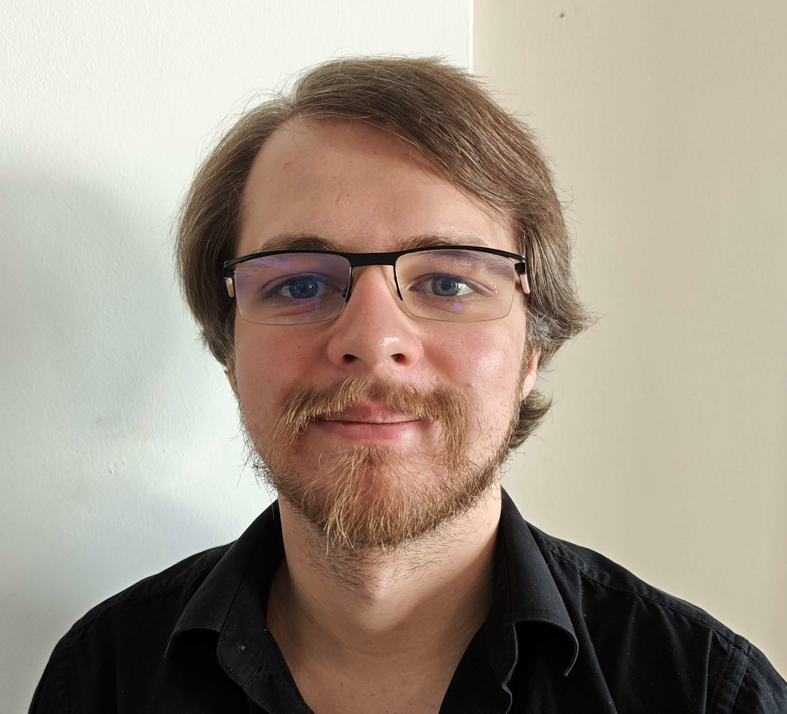

<h2>About</h2>
<pre>
My favourite question is the toddler's 'But why?'. The universe has yet to provide a satisfactory answer. Letting my curiosity guide me, I have found myself on a fantastical journey through the vast and fractal landscape of mathematics. And that journey is what 'But why?' is all about, not some mystical destination. Understanding, not mere collection of facts.

My research branches out from Strict Deformation Quantization, which on a technical level boils down to the convergence for vector-valued power series. As such, my toolbox contains much of locally convex functional analysis, a great deal of complex analysis and scattered fragments of algebra providing guidance and structure. Moreover, Lie groups and their representation theory have provided a fruitful setting with numerous worthwhile 'But why?'s of their own. When nobody is looking, I replace finite-dimensional objects with their infinite-dimensional counterparts.

In my non-mathematical time, I consume unwise amounts of fantasy and science fiction, and challenge myself with board as well as video games.
</pre>

<h2>Coordinates</h2>
<pre>
Institute of Applied Mathematics
Delft University of Technology
Mekelweg 4
2628 CD Delft
Netherlands
</pre>

<h2>Mail</h2>
<pre>
  michael[dot]heins[dot]mathematics[at]gmail[dot]com
  or
  mheins[at]tudelft[dot]nl
</pre>

<h2>Schematic Picture</h2>

<h2>Preprints</h2>
  <ol>
  <li>
    M. Heins, <em>Boundedness in Strict Deformation Quantization</em> 
    <a href="https://arxiv.org/abs/2609.16250">arxiv:2609.16250</a>
  </li>
    
  <li>
    C. Esposito, M. Heins, S. Waldmann, <em>Convergent Twist Deformations</em> 
    <a href="https://arxiv.org/abs/2602.16593">arxiv:2602.16593</a>
  </li>
    
  <li>
    M. Heins, <em>Entire Functions on Lie Groups</em> 
    <a href="https://arxiv.org/abs/2512.07479">arxiv:2512.07479</a>
  </li>
  </ol>

<h2>Journal Articles</h2> 
<ol>
  <li> M. Heins, O. Roth and S. Waldmann, <em>Convergent star products on
    cotangent bundles of Lie groups</em>, Math. Ann. <strong>386</strong>, 2023, 151–206, see
    <a href="https://arxiv.org/abs/2107.14624">arXiv:2107.14624</a>. 
  </li>
  
  <li> 
    M. Heins, A. Moucha and O. Roth, <em>Spectral theory of the invariant
    Laplacian on the disk and the sphere – a complex analysis approach</em>, Canadian Journal
    of Mathematics, <strong>77</strong>(3), 2025, 940–974, see
    <a href="https://arxiv.org/abs/2308.01107">arXiv:2308.01107</a>
  </li>

  <li> 
    M. Heins, A. Moucha, O. Roth and T. Sugawa, <em>Peschl-Minda
    derivatives and convergent Wick star products on the disk, the sphere and beyond</em>, 
    J. d'Analyse Math. <strong>157</strong>, 2025, 361–400, see
    <a href="https://arxiv.org/abs/2308.01101">arXiv:2308.01101</a>
  </li>

  <li>
    M. Heins, A. Moucha and O. Roth, <em>Function Theory off the complexified
    unit circle: Fréchet space structure and automorphisms</em>, Annales Fennici Mathematici <strong>49</strong>.1,
    2024, see 
    <a href="https://www.cambridge.org/core/journals/canadian-journal-of-mathematics/article/spectral-theory-of-the-invariant-laplacian-on-the-disk-and-the-sphere-a-complex-analysis-approach/CE34EE3613AB23A78DF0E00D78DF8A98">doi:10.4153/S0008414X2400021X</a>
  </li>
</ol>

<h2>Thesis</h2>
M. Heins, <em>A Holomorphic perspective of Strict Deformation
Quantization</em>, 2024, PhD thesis, Julius-Maximilians-Universität Würzburg,
see <a href="https://arxiv.org/abs/2504.12862">arXiv:2504.12862</a>

<h2>Lecture Notes</h2>
<a href="Locally Convex Analysis in Differential Geometry.pdf" class="image fit">Locally Convex Analysis in Differential Geometry</a>

<h2>Slides</h2>
<a href="ConvergentTwistDeformationsSlides.pdf" class="image fit">Convergent Twist Deformations</a>
